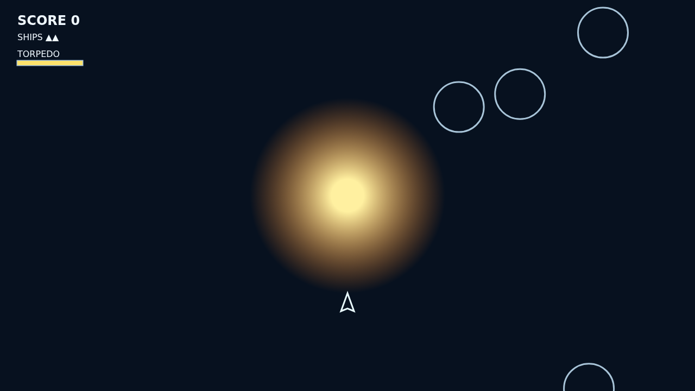

# Shatter

Shatter is a fast, momentum-driven rock shooter played around a dangerous gravity well. Turn, burn, and use the star as part of the battlefield: your ship flies true while bullets and drifting rocks bend through its pull.

Large rocks wear armor, then split into smaller and faster fragments. Clear every last shard to bring in the next wave — but rocks swallowed by the star are thrown back from the edge, still scarred and still moving.

The torpedo is the emergency answer: one guided shot every ten seconds, seeking the nearest target in its narrow forward cone and flying straight through the gravity that curves everything else.

Keep moving. A hunting saucer eventually crosses the field, firing through the chaos, and every curve around the star can become either a perfect shot or a catastrophe.
